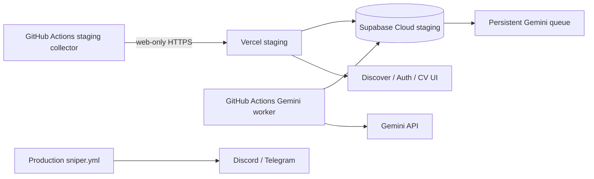

# ATS Sniper staging deployment

## Status

The repository contains isolated staging workflows for scheduled or manual execution. They require a separate Supabase Cloud project, Vercel project, and environment-scoped secrets. The production bot workflow remains separate.

## Architecture



The staging collector never invokes Discord or Telegram. The existing `sniper.yml` production workflow is not modified.

## Required staging secrets

Configure these as Vercel/GitHub environment-scoped secrets, never in Git:

- `NEXT_PUBLIC_SUPABASE_URL`
- `NEXT_PUBLIC_SUPABASE_ANON_KEY`
- `SUPABASE_SERVICE_ROLE_KEY`
- `ATS_INGESTION_SHARED_SECRET`
- `GEMINI_API_KEY`
- `ATS_STAGING_INGESTION_API_URL`
- `ATS_STAGING_SUPABASE_SERVICE_ROLE_KEY`
- `ATS_STAGING_GEMINI_API_KEY`

Set `ATS_AUTO_MATCH_ENABLED=false` initially. Enable it only after the bounded staging test, with `ATS_AUTO_MATCH_USER_ID` set to the authorized staging user.

## Workflows

- `ats-platform-ci.yml`: Python tests, Gemini policy/result tests, lint, typecheck, build, and diff hygiene.
- `ats-staging-collector.yml`: every 15 minutes or manual, bounded web-only collection; maximum 10 jobs and 10 detail requests.
- `ats-staging-gemini.yml`: every 15 minutes or manual, maximum 2 queued tasks per run, 14 RPM ceiling, daily budget of 2.
- `sniper.yml`: production workflow; protected and unchanged by this staging work.

GitHub scheduled workflows only run from the repository default branch. The staging workflows therefore require the feature branch to be reviewed and merged through the normal process before unattended collection begins.

## Supabase Cloud setup

Create a separate staging project, then apply migrations in order with the Supabase CLI after authenticating to that project. Do not run `db reset`, `supabase link`, or migration commands against production. Configure Auth redirect URLs for the Vercel staging URL and create the private `cv-documents` bucket through the migrations.

The `staging_collector_state` table preserves provider IDs, canonical URLs, description state, and timestamps. Job and queue uniqueness remain database-enforced. The GitHub runner's temporary SQLite file is not treated as the durable source of truth; it is only a bounded compatibility state for the existing collector, while Supabase stores ingested provider state.

## Vercel setup

Create a separate Vercel project with root directory `apps/web`, framework preset Next.js, and the staging variables above. Keep service-role and Gemini keys server-only. Add the staging callback URL to Supabase Auth before testing signup, recovery, CV upload, and session refresh.

## Cost controls

- Collector: 10 jobs and 10 detail requests per manual run.
- Gemini worker: 2 tasks and 2 daily attempts in the verification workflow.
- Database limiter: maximum 14 requests per rolling 60 seconds.
- No always-on worker, paid monitoring, or production schedule activation.
- Disable staging by removing workflow secrets and setting `ATS_AUTO_MATCH_ENABLED=false`.

Gemini free-tier eligibility, daily quota, token quota, and billing status must be confirmed in the account before enabling live staging calls. The workflows do not enable billing or silently change models.

## Verification and rollback

Run CI first. Then manually run the collector workflow, inspect one genuine job in staging, run the Gemini workflow with at most two tasks, and verify the score in Discover. Reingest the same job to verify idempotency. Roll back application code through the normal feature-branch revert; disable the two staging workflows and rotate staging secrets if a credential is exposed. Never reset production or modify `jobs_seen.db` as a rollback mechanism.

## Local development

```powershell
.\scripts\supabase-local.ps1 start
cd apps/web
npm run dev
npm run gemini:worker
```

Automatic matching remains disabled locally unless explicitly enabled for a bounded test. See `docs/automatic-matching.md`.
